# Frostbound · 实时技能实验室

Vite + Three.js + WebGL2 的原创 3D 技能实验室，包含可切换的 **修士 · 元婴法相天劫**、**剑客 · 苍雷断空斩** 与 **射手 · 寒霜贯星**。修士以双手结印召出缓慢起身后站定的巨大蓝白灵体，并从天空法阵引下连续陨石轰击。剑客旋身挥出有真实厚度的月刃，携整体连续尾流与分叉雷电命中；射手自然拉弓，生成式冰晶箭与六支伴随小箭分别爆发冰霜冲击。几何、飞行、拖尾、碎片、角色状态与相机都在浏览器实时计算，AI 用于离线资产制作。

界面采用浅色极简面板，3D 训练场使用深灰蓝背景、暖中性主光、冷色轮廓光与实时阴影。三套技能各有独立演出：修士八镜头表现低机位起身、巨灵近景、召星、陨石俯冲、轰击与余烬，剑气五镜头保留月刃正面，冰箭六镜头包含飞行正反打特写。新增剑客保留源动作的 360° 旋身；原射手与受击角色的 FBX、材质和冰箭技能继续保留。

默认展示元婴修士。法相以完整轮廓整体渐显，播放专属 `Standing (1).fbx` 起身动作后站定；显圣镜头采用低机位上仰、缓慢推进与升镜，随后压近上半身。外围双环降低辉光并移除中央花纹，周围纹理飘带已去除；光轮随头部、腰部的中点重新居中，减少下方留白。法阵会连续发射 **48 发蓝白追踪灵光**，沿弧线飞向敌人，附带连续拖尾、命中闪光和碎片；“粒子密度”可将其增至 **96 发**。默认 60 枚陨石各有独立轨迹、落点、拖尾和碎岩冲击，可调至 84 枚。模块、八镜头、时间轴与接入方式见 [法相天劫说明](docs/cultivator-skill.md)。

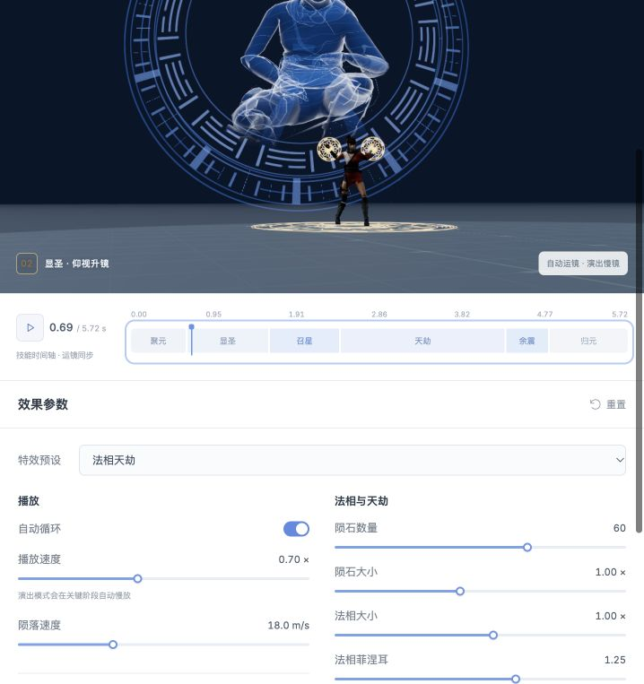

显形初期头部、双臂与躯干同步可见，随后全身逐渐清晰。

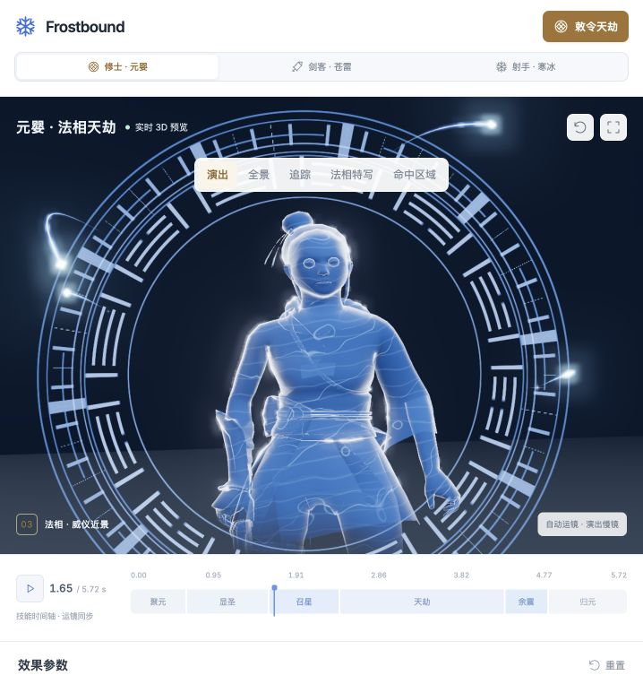

法相使用独立的起身动作，播完保持站姿；近景随头部与胸部位置取景。

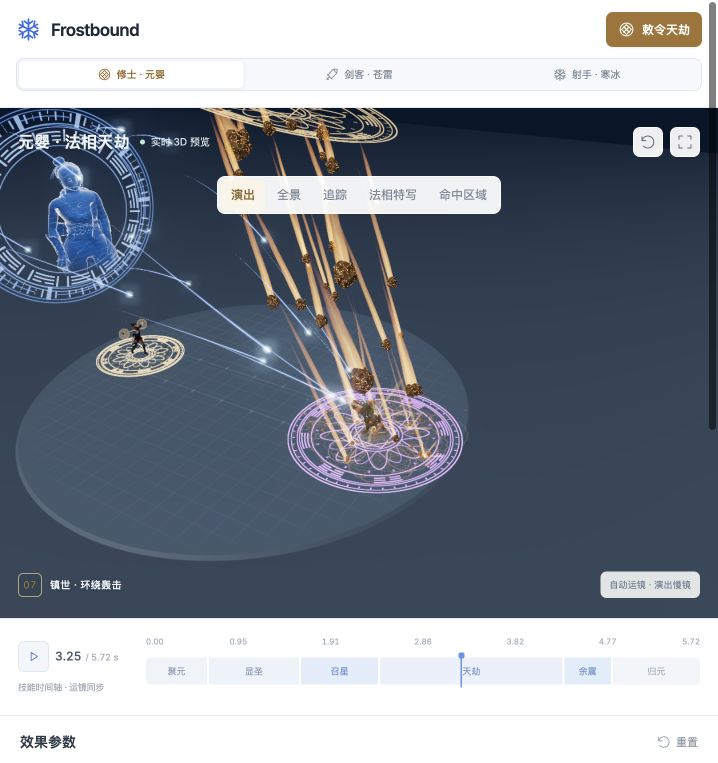

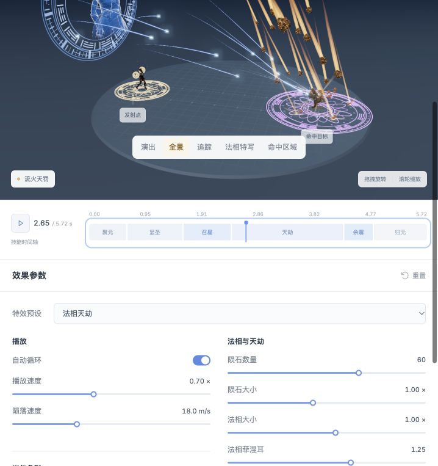

灵光从真实旋转符文位置出发，向外展开后收束至敌人的受击位置。

以下保留苍雷剑客与寒冰射手的完整实现。最终采用的生成长剑 `storm-sword-v3` 已确认模型与握持正确；月刃以生成式 RGBA 手绘素材确定轮廓与色块，再从透明轮廓构造有厚度的闭合 3D 网格。白青亮芯、青蓝色带与不对称尖端保留原图细节，流动和显形由 Shader 驱动。月刃的位置与平面跟随真实剑尖和挥剑动作，整体半透明拖尾贴合其实际后缘。模块、七类粒子、雷爆与接入接口见 [苍雷·断空斩说明](docs/sword-skill.md)。

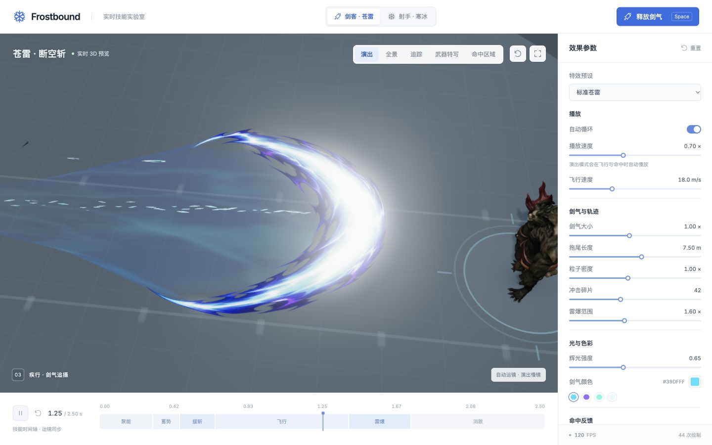

生成剑随右掌旋身挥斩，真实剑身轨迹在出手时展开。

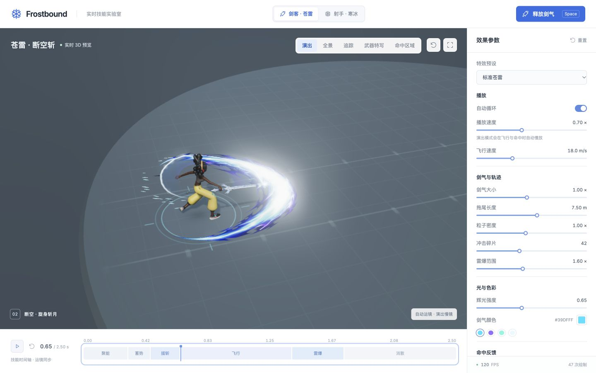

0.65 秒前向出剑时刻，月刃从剑尖附近沿实际挥砍平面释放。

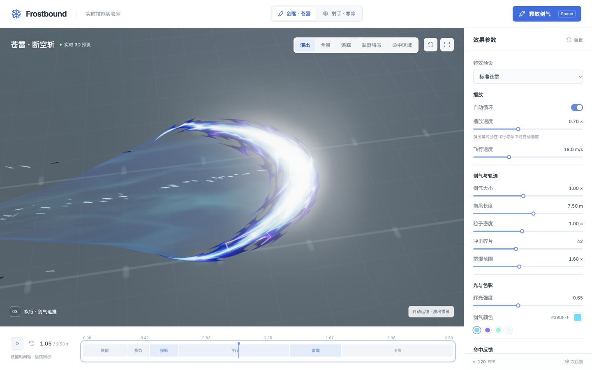

宽白青能量芯、清晰色带、尖锐后缘与连续收尖的尾流共同表现速度。

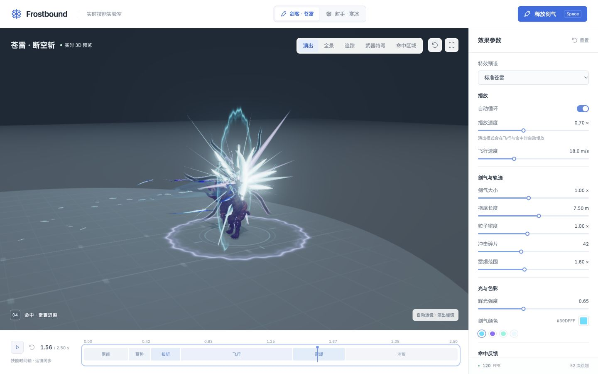

命中包含白青弧斩、定向亮刃、暗色飞片、冲击波与分叉雷电。

以下保留原寒冰射手演出，顶部角色按钮可随时切换。

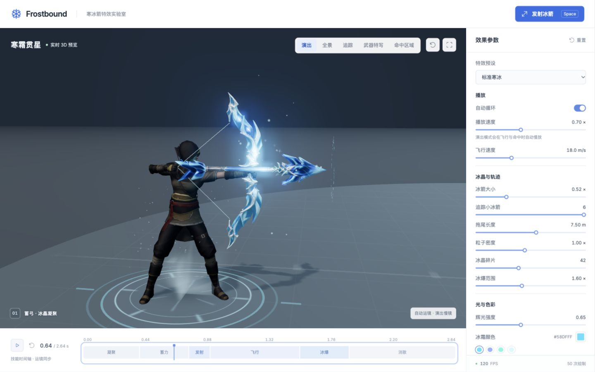

左手掌握弓，右手勾弦；箭尾与动态弓弦共享实际指尖搭箭点。

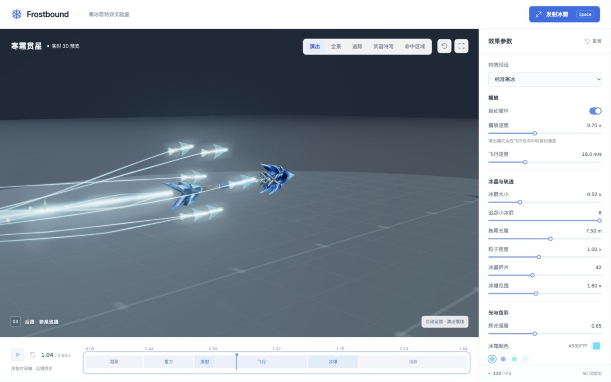

后侧斜角跟随飞行，清楚展示整支冰箭、晶体切面与近端拖尾。

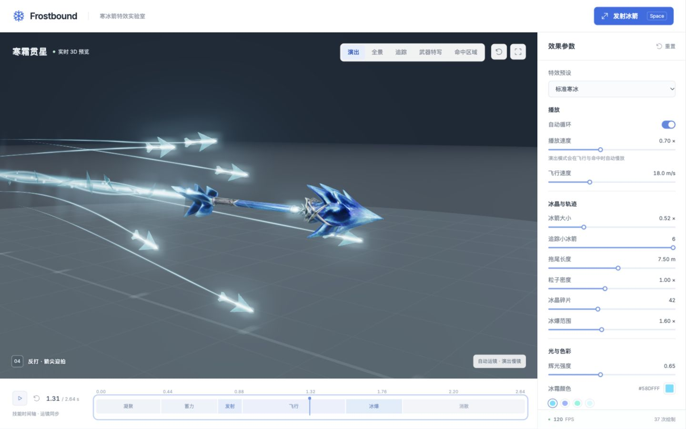

镜头移至箭前方后退跟拍，正反打切换时保持箭体中心匹配。

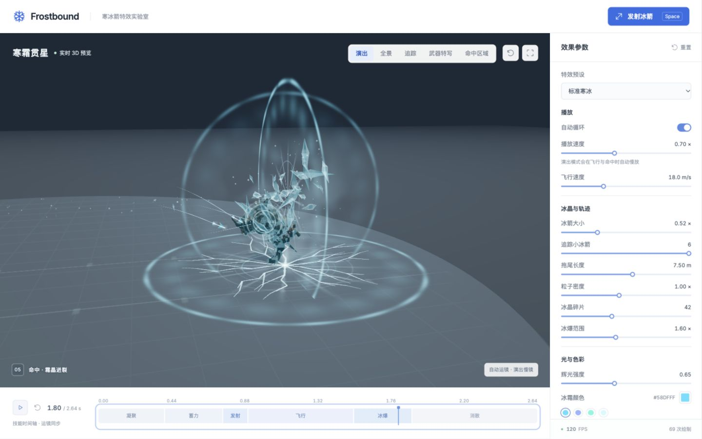

命中镜头覆盖主箭冲击与六支追踪箭的错峰冰爆，随后拉远展示余霜消散。

## 星炉与新觉醒

新增 35 级 **H · 天刃镇岳**、40 级 **J · 万象冰劫**，各有全屏职业立绘、运镜、实体巨刃/冰暴与真实范围伤害。按 **I** 管理五类普通/稀有/史诗装备，按 **B** 进入灯台商会购买、回收、修行与最高 **+20** 强化。穿戴改变角色实际外观与属性，强化光色连续从浅蓝进阶到金色；失败不掉级。兼容原本地存档。规则、操作与数值见 [装备与觉醒说明](docs/game/EQUIPMENT-AND-AWAKENINGS.md)，文生图/图生 3D 资产记录见 [素材制作](docs/game/EQUIPMENT-ART.md)。

本轮新增 **星羽/凤翼、星河法衣/帝阙凤氅、进阶长弓与刀剑**，披风和羽翼具有速度、急停与转身惯性。装备翻转着沿抛物线落地。普通掉落闪银白晶芒，稀有闪紫光，史诗爆出不等长金色光束。三档各有独立的爆出声和落地声。天刃以刀刃向下劈击，冰暴锁定敌人后垂直下刺。详见 [第二轮视觉与性能打磨](docs/game/EQUIPMENT-V2.md)。

游戏中按 **M** 可追踪区域清剿并领取每轮悬赏，按 **I** 可锁定装备。满包时优先保留高品质掉落，灯台轮回会结算地面装备。三职业五轮通关和存档验收见[旅程与玩法复核](docs/game/EQUIPMENT-V2.md#旅程与玩法复核)。


## 霜界 · 归墟之门：单机动作 RPG

页面顶部的 **进入霜界 RPG** 打开独立游戏，也可直接访问 `http://127.0.0.1:5173/game.html`。原技能实验室完整保留。

- **三种流派**：苍雷剑客远程剑气、霜羽行者远程冰箭、太虚修士追踪灵光；共享 Q 冻结、E 月刃、R 法相陨星三个技能。
- **完整旅途**：听雪林地 → 悬星遗迹 → 归墟王座，9 场遭遇、两道封印、五个宝箱、两段记忆、三阶段首领和通关奖励。
- **成长与重玩**：装备比较和替换、升级三选一、灯台淬炼、自动存档、死亡恢复与保留成长的轮回。
- **操作**：WASD / 方向键移动，右键自动绕障移动，鼠标瞄准，按住左键普攻，Q / E / R 技能，Space 闪避，C 治疗，F 交互，I 行囊，M 地图，Esc 暂停，滚轮调整镜头距离。
- **表现与运行**：原创生成主视觉和道具图集、生成式星环灯台与武器、Mixamo 动作、CC0 植被和遗迹、Shader 技能、程序音效、实例化场景、对象池与动态分辨率。标题界面不预载 3D 引擎，暂停时不重复渲染背景。

桌面键鼠为主要操作方式。存档保存在当前浏览器和站点地址；开发与 preview 端口的存档互相独立。开启新旅途会备份上一份存档到同一浏览器的本地存储，标题页可随时切换回上一旅途。

资源与制作流程见 [游戏素材来源](docs/game/ASSETS.md)，实机验收见 [游戏实现与验证](docs/game/DEVELOPMENT.md)。运行版不调用任何生成 API。`npm run build` 同时输出实验室和游戏入口；`npm run preview -- --port 4173` 验证生产版。

## 运行

需要 Node.js 20.19+ 或 22.12+、支持 WebGL2 的桌面浏览器。

```bash
npm ci
npm run dev
```

打开终端输出的本地地址，默认 http://127.0.0.1:5173 。

```bash
npm test        # 时间轴、角色、相机、粒子、命中过渡及资源复用测试
npm run build  # 生产构建，输出 dist/
npm run preview
```

`dist/` 可部署到静态 HTTP 服务。已验证的运行版武器、程序化回退、角色和字体随项目提供；安装完成后，预览不依赖外部 CDN、图像服务或 API Key。不要直接用 `file://` 打开 `index.html`。

## 操作

- **角色切换**：顶部选择“修士 · 元婴 / 剑客 · 苍雷 / 射手 · 寒冰”，切换技能、专属参数、时间轴标签及演出相机。
- **Space / 敕令天劫 / 释放剑气 / 发射冰箭**：立即重新释放当前技能。
- **P**：暂停、继续；时间轴末尾按 P 会重播。
- **C**：切换演出 / 全景相机。
- **← / →**：暂停并按技能时间前后移动 1/60 秒，逐帧检查。
- **R**：恢复全景相机。
- **时间轴**：拖动定位至任意阶段并自动暂停，可反复检查形成、命中与冻结过程。
- **OrbitControls**：在全景、武器特写和命中区域模式中拖拽旋转、滚轮缩放、右键平移；追踪和演出模式由相机控制器接管。
- **相机模式**：演出（默认）、全景、追踪、武器特写、命中区域。演出模式显示当前镜头序号与名称。
- **参数面板**：共享自动循环、播放速度、飞行速度、粒子密度、碎片数量、拖尾长度、辉光与爆发范围；修士有陨石数量、陨石大小、法相尺度、菲涅耳强度、灵体配色及法阵颜色；剑客有月刃大小、剑气颜色及命中停顿/震屏/闪光开关，射手保留箭体大小、追踪小冰箭数量（0–6）与冰霜颜色。
- **预设**：剑客为标准苍雷、雷霆重斩、清透剑芒；射手为标准寒冰、极光重击、清透冰晶。切换预设保留相机模式，重置参数保留当前角色并恢复默认参数及演出模式。

参数在播放或暂停时都可修改。改变飞行速度或主体大小会重算接触距离与飞行时间，保持当前归一化进度；命中后修改速度保留当前爆发年龄。

剑气默认 `bladeSize = 1`，月刃局部包围尺寸约 **3.567 × 3.6 × 0.08 m**，共 **9,856 三角形**。其世界朝向来自剑尖的实际运动平面，当前旋身动作形成近水平斩面；相机随斩面提高观察角度。0–0.45 秒围绕实际剑身聚能，0.45–0.65 秒沿手绘轮廓单向显形，实体剑同时留下骨骼驱动的挥剑残影。源 FBX 的 **1.075 秒前向出剑姿势**映射到技能 **0.65 秒**释放；命中与结束时间按实际距离重算，默认约 1.4 / 2.5 秒。命中后月刃在 220 ms 内侵蚀、拖尾在 340 ms 内收束；可选 50 ms 实际时间停顿只作用于播放，不影响暂停定位。完整说明见 [剑技能文档](docs/sword-skill.md)。

以下为原寒冰射手的参数与时间轴。

默认主箭大小为 **0.52×**，实际长度约 **1.78 m**（`3.42 × 0.52`），约为早期 1.15× 版本长度的 45.2%。全局播放倍率默认为 **0.70×**，默认飞行速度为 18 m/s。演出模式在全局倍率上叠加分段慢镜节奏；其余相机模式仍只使用全局倍率。

下述时间均为技能时间；演出慢镜改变实际观看时长，不改变时间轴上的发射和命中时刻。飞行起点从角色 **0.75 秒释放姿势**精确采样。当前 FBX 校准下，主箭约在 **1.535 秒**命中，整轮约 **2.635 秒（2.64 秒）**；时间不是固定常量。改变箭体大小、飞速或持弓姿势后按实际距离重算，以界面时间轴为准。

| 阶段 | 当前默认时间（约） | 视觉表现 |
| --- | --- | --- |
| 凝聚 | 0–0.40 s | 螺旋粒子、箭体轴向显形、发射者寒气 |
| 蓄力 | 0.40–0.75 s | 自然拉弓、主箭晶体纹路、地面符文；末 0.08 s 压缩增亮 |
| 发射 | 0.75–0.90 s | 主箭闪光射出；0.80 秒起小箭从箭尾依次凝出 |
| 飞行 | 0.90–1.54 s | 主箭连续拖尾，小箭旋绕后分流追踪；寒雾、微晶和雪花 |
| 冰爆 | 1.54–1.89 s | 主箭从尖到尾消解、拖尾收束入命中点、冲击环与目标结霜 |
| 消散 | 1.89–2.64 s | 小箭完成错峰命中，碎片下坠缩小，角色和地面霜纹融化 |

主箭命中后在 **180 ms** 内沿接触面从尖到尾消解，主拖尾在 **340 ms** 内收束到同一个命中点。

六支小箭于技能时间 **0.80–0.925 秒**依次出现，即主箭释放后 50–175 ms，先从尾部向伴飞轨道展开，再分别在主命中后的 **60、130、200、270、340、410 ms** 击中胸口，每次均产生独立冰爆。小箭在 **120 ms** 内从尖到尾消解，拖尾贴着移动胸口在 **240 ms** 内收束；命中伴随短促闪光、扩张冰环、9 片带厚度的旋转冰晶、薄雾和冰霜颗粒，全部冰爆层在 **0.58 秒**内消散。

小箭默认长约 **0.36 m**，HDR 箭尖、内核与拖尾通过现有 Bloom 后处理产生局部辉光；辉光强度可在面板实时调节。

## 寒冰射手演出与共享灯光

`CinematicDirector` 按技能时间组织六个镜头。飞行段包含从箭后方追拍和从箭前方后退跟拍的正反打特写；两机位均保持在动作轴线的 +Z 同侧，切镜时匹配箭体中心，维持空间方向。镜头序号和名称显示在预览左下角。

| 镜头 | 标识 | 演出内容 |
| --- | --- | --- |
| 蓄弓 · 凝聚 | `draw` | 缓慢推进，保留上半身、双手、整张弓和成形冰箭 |
| 离弦 · 破空 | `flight` | 飞行进度前 18% 使用较宽构图，交代发射者、箭体和飞行方向 |
| 后跟 · 箭尾追摄 | `rear` | 飞行进度 18%–56%，从箭后侧斜角追拍完整箭体与近端拖尾 |
| 反打 · 箭尖迎拍 | `front` | 飞行进度 56% 后，镜头在箭前侧后退跟拍，突出箭尖与迎面穿透感 |
| 命中 · 霜晶迸裂 | `impact` | 切至目标并保持构图，覆盖主箭冰爆与六次错峰追击 |
| 余霜 · 消散 | `resolve` | 最后一次追击后缓慢拉远并轻微环绕，展示冰晶下坠和融霜 |

飞行进度以发射到主命中之间的归一化时间计算。两段特写优先保留**整支箭体与近端拖尾**：后侧最多 1 m、前侧最多 0.75 m，长度受当前已生成轨迹限制；较长的历史拖尾继续实时渲染，但可以伸出画面。全景模式可用于观察完整飞行轨迹。

镜头由技能时间、当前参数和视口比例直接计算，不依赖上一帧相机位置。暂停、向后定位、重新释放和逐帧检查可复现相同构图。窄屏根据各镜头主体包围范围自动调整距离：蓄力保留完整弓身，飞行特写保留完整箭体和近端拖尾。选择其他相机模式后不会自动切回演出。

演出节奏在凝聚与蓄力阶段使用约 **0.72×** 附加倍率，后侧跟拍与前侧反打特写分别约 **0.48× / 0.42×**；主命中及六次追击约 **0.46×**，消散阶段逐渐恢复至 **1×**。这些倍率与面板“播放速度”相乘；具体分段过渡由 `CinematicDirector.getTimeScale()` 编排，时间轴仍显示技能秒数。按 **P** 暂停、按 **← / →** 单帧移动，或拖动时间轴即可检查任一镜头。

`StudioLighting` 使用暖中性主光、冷色后侧轮廓光、低强度正面补光和环境反射，保留角色肤色、银饰与深蓝冰晶的层次。主光产生 **2048×2048 PCF 阴影**，地面再叠加柔和接触阴影；暗灰蓝舞台、较淡网格和克制的环境亮度提升技能与背景的分离度。随技能变化的冰蓝反射补光位于主体上方和前侧，凝聚、发射与命中时增强后自然衰减。

相机更新后，入口调用 `skill.refreshView()`，以零时间步刷新面向相机的拖尾与追击表现。镜头切换和暂停定位不会额外推进粒子生命周期，也不会让带状拖尾滞后一帧。

## 生成武器资产

三件武器均已在浏览器验证。详细规格、生成记录和复现命令见 [生成资产说明](docs/generated-assets.md)，剑概念与流动纹理的完整图像提示词见 [图像生成记录](docs/sword-generation-prompts.md)。

- 运行版：`public/models/frost-arrow-v2.glb`、`public/models/frost-bow-v2.glb`，各 **140,000 三角形**，约 **6.82 MB / 7.28 MB**。
- 冰箭/弓母版：本地 `assets/generated/*-master.glb`，各 **1,000,000 三角形**，约 **64.78 MB / 66.54 MB**。
- 苍雷剑运行版：`public/models/storm-sword-v3.glb`，**67,302 三角形、3.26 MB**；本地母版 **336,519 三角形、19.89 MB**。总长归一化为 **1.5 m**，握点为底部向上 **17%**。母版不直接进入浏览器。
- 这两件冰霜武器各保留三张 **4096×4096** 贴图：基础色、法线、金属度/粗糙度。运行版使用 WebP，母版使用 PNG。
- 苍雷剑有两张 **4096×4096** WebP：基础色及金属度/粗糙度，**没有法线贴图**，保留网格法线。
- 月刃源图为 `public/textures/anime-crescent-v1.png`，**1254×1254 RGBA、936,405 B**。浏览器一次性提取其透明轮廓、构建厚月刃并保留原图 UV；不是播放图片序列或视频。
- 原始概念图在 `public/concepts/`，能量流动纹理在 `public/textures/`。冰箭/弓使用 Ark 的 `hyper3d-gen2-260112`；最终剑使用同一任务端点的 `doubao-seed3d-2-0-260328` 图生 3D，再进行网格简化与纹理压缩。被拒绝的两轮剑模型不在运行资源中。
- 源码 ZIP 包含运行版 GLB、概念图、角色和再生成脚本；较大的母版保留在本地 `assets/generated/`，不放入源码 ZIP。任务状态目录 `.generation/` 和任何凭据也不进入交付包。

详细清单、原始 3D 提示词、生成参数及复现命令见 [生成资产说明](docs/generated-assets.md)。

## 模块

```text
src/
  main.js                     应用入口、资源等待、RAF、预览状态
  VFXConfig.js                默认参数、发射点和目标位置
  SkillShowcase.js            三角色选择、共享目标、UI 与相机的稳定接口
  scene/
    SceneManager.js           训练场、相机模式、OrbitControls、后处理
    CinematicDirector.js      冰箭六镜头、正反打跟拍、窄屏取景与慢镜节奏
    SwordCinematicDirector.js 剑气五镜头、月刃正面追摄、确定性震屏
    Cultivator.js            元婴施法 FBX、原始贴图与材质分组合并
    CultivatorCinematicDirector.js  法相天劫八镜头、低机位起身、俯冲跟拍与画幅适配
    SwordFighter.js           旋身挥剑 FBX、右手武器、动作与剑尖姿势采样
    SwordWeapon.js            实体倒角剑回退、生成剑加载与握点校准
    StudioLighting.js         暖主光、冷轮廓、PCF 阴影和技能反射补光
    Actors.js                 FBX 动作同步、动态弓弦、发射与胸口位置采样
    ArcherPose.js             左手握弓、右手勾弦、手臂接触校正与释放过渡
    GeneratedBowAsset.js       生成弓加载、握点校准、PBR 材质与蓄力能量
  vfx/
    SkillTimeline.js          六阶段时间轴、动态重定时
    IceArrowSkill.js          释放、暂停定位、箭体加载、命中事件
    GeneratedArrowAsset.js    生成箭加载、方向归一化、PBR 上的 GLSL 显形
    IceArrowMesh.js           程序化冰晶箭回退、内核、裂纹、蓄力环
    FrostTrail.js             历史轨迹环形缓冲、五层 GLSL 带状拖尾
    FrostParticles.js         固定容量粒子池、实体微晶实例
    IceImpact.js              冲击环、厚冰晶碎片、寒雾、地面结霜
    HomingArrows.js            六支伴随小箭、曲线分流、胸口追踪、命中消解
    HomingImpactBurst.js       独立小箭冰爆、冲击环、实体碎冰、寒雾与霜粒
    CharacterStatusFX.js      发射者蓄力气场、骨骼霜层、附着冰晶与融化
    sword/
      SwordSlashSkill.js      剑气控制、姿势校准、命中事件与非阻塞停顿
      SwordTimeline.js        0.65 秒发射与按距离重定时的时间轴
      PaintedCrescentBlade.js 手绘透明轮廓转厚 3D 月刃、原图 UV 与流动显形
      CrescentBlade.js        纹理加载前或失败时使用的程序化月刃回退
      SwordTrail.js           单一连续体积拖尾、真实后缘与姿态历史、接触点收束
      SwordSwingTrail.js      实体剑骨骼端点的真实挥剑残影
      SwordParticles.js       七类粒子、1200 槽点粒子与 192 个碎片实例
      BranchingLightning.js   多段分叉雷电与可复用带状缓冲
      SwordImpact.js          六层雷爆、实体碎片、双冲击环与空间裂痕
      SwordAura.js            围绕实际剑身收束的三条能量带
    cultivator/
      CultivatorSkill.js      结印、法相、法阵与天劫总控
      DivineAvatar.js         Standing 专属动作、整体显形与 Fresnel Shader
      DivineHalo.js           外围双环、中央留白、正反旋转与克制辉光
      HaloBolts.js            默认 48 发、上限 96 发追踪灵光、曲线历史拖尾、独立命中与碎片池
      MagicMandala.js         极坐标法阵、莲瓣、八区符文
      MeteorStorm.js          实例化陨石、历史轨迹、独立命中与碎岩
  ui/ControlPanel.js          参数与时间轴面板
  style.css                   自适应浅色界面
public/
  concepts/                   冰箭、反曲弓与苍雷剑概念图、3D 参考输入
  textures/                   月刃 RGBA 手绘素材与能量流动纹理
  models/                     四份角色 FBX、法相 Standing 动作、运行版武器 GLB
  fonts/                      本地字体及 OFL 授权文件
assets/generated/             高精 GLB 母版，仅本地素材工程保留
scripts/generate-assets.mjs    离线图生 3D 生成、任务恢复与母版下载
docs/generated-assets.md      资产规格、生成状态与复现说明
docs/sword-skill.md            剑气动作、几何、粒子、雷爆和接入说明
docs/sword-generation-prompts.md  图像生成提示词与实际输出规格
tests/                        Node 原生测试，无测试框架依赖
```

## 渲染与性能设计

- `GeneratedArrowAsset` 保留基础色、法线、金属度/粗糙度贴图，以 `onBeforeCompile` 叠加显形、流光、Fresnel 和命中碎裂消解。命中后保持箭体尺度，向接触面推进，同时由箭尖向箭尾消解，避免整箭突然隐藏。加载失败时保留程序化冰晶箭。
- `GeneratedBowAsset` 将生成弓映射到角色持弓坐标，保留 PBR 材质；按已校准范围在内存副本中移除静态弦，再用动态弓弦表现拉动。握点、弦锚点和静态弦裁切范围由 `main.js` 配置，磁盘 GLB 不变。
- `ArcherPose` 将源动作的 0.015–0.155 秒映射到蓄力阶段，以左掌确定握点、右手指尖确定搭箭点；两关节接触校正维持手、弦和箭尾一致，释放后在 90 ms 内平滑退出校正。
- 冰箭拖尾记录真实历史位置，以距离细分，使用 384 槽环形历史缓冲和每层 256 组带状顶点。五层带状特效跟随箭尾方向和大小，命中后收束至接触点。
- `PaintedCrescentBlade` 从 RGBA 的最大连通主体提取轮廓，构造带薄透镜截面的闭合网格，保留原图比例、UV、青蓝色带和不对称尖端；三层 FBM 与少量灰度流动纹理只调节亮度、移动高光及侵蚀。实体剑的方向和剑尖速度共同确定挥剑平面，月刃形成时贴随剑尖，释放后平滑对准目标。
- 剑气拖尾使用 384 槽位置与 quaternion 历史池，以 25 点曲线截面连接手绘月刃的实际后缘，构成单一、有浅厚度的连续网格。高速补点同时插值姿态，保留挥剑时的平面变化；截面向后迅速收尖，内部青蓝/紫流动、边缘侵蚀与低透明度保留月刃缺口。只有一个拖尾 Mesh，没有独立中央光绳或上下两条轨道。
- `SwordSwingTrail` 在 0.45–0.65 秒采样实体剑根和剑尖，用固定 64 槽历史构造短挥剑残影，0.82 秒前消失。
- `HomingArrows` 用实例化几何与固定轨迹缓冲表现六支约 0.36 m 的小箭。各箭在主箭发射后凝聚、展开至伴飞轨道，再从旋绕路径平滑分流，终点采样自受击动作的 `Spine2` 胸口骨骼；未来命中位置按每轮缓存，重定时后更新。HDR 亮度集中在窄内核、箭尖和拖尾中心，保留外围蓝色晶面。
- `HomingImpactBurst` 为每次小箭命中提供独立闪光、冰环、9 片实体碎冰、寒雾和霜粒；碎冰带随机旋转、重力、缩小与淡出，资源预分配并复用，所有爆发层在 0.58 秒内消散。
- 冰箭粒子使用固定 1000 槽 `BufferGeometry` 和 160 个微晶实例；命中冰晶最多 96 实例。粒子具有独立生命、速度、尺寸、旋转和透明度。
- 角色结霜使用独立蒙皮叠层，共享角色骨骼、保留原始人物材质，并对头颈区域降低覆盖。18 个骨骼附近的冰晶随动作运动，冻结与融化按技能时间计算，暂停定位也可复现。
- 冰箭模拟限制单步至 1/90 秒，剑气使用 1/120 秒子步。拖动时间轴时从池状态重置并按 1/120 秒回放；终点清理瞬态特效，支持重复释放。剑气的 50 ms 停顿使用独立真实时间计时，定位回放跳过停顿。
- 三套导演都直接取样技能时间，以主体包围范围适配视口；剑气飞行保留完整月刃与 3.1–3.7 m 近端轨迹，避免薄月刃变为不可辨识的侧边。`StudioLighting` 独立管理环境与技能反射补光。切镜后零时间步刷新拖尾几何。
- `EffectComposer → RenderPass → UnrealBloomPass → OutputPass`；HDR 半浮点缓冲、4× MSAA、ACES Filmic 色调映射、sRGB 输出。设备像素比上限为 1.75。
- 三件运行武器 GLB 合计 347,302 三角形，按当前选择显示相应武器；持弓时在内存中移除 1,206 个静态弦三角形，弓体实际为 138,794 三角形，另有动态弦、角色、阴影与后处理开销。性能栏显示当前浏览器实际 FPS 和整帧绘制调用计数；性能随 GPU、视口分辨率和浏览器变化。

官方 API 参考：[EffectComposer](https://threejs.org/docs/pages/EffectComposer.html)、[OutputPass](https://threejs.org/docs/pages/OutputPass.html)、[颜色管理](https://threejs.org/manual/pages/color-management.html)。

## 接入现有 Three.js 项目

```js
import { IceArrowSkill } from './src/vfx/IceArrowSkill.js';
import { defaults } from './src/VFXConfig.js';

const parameters = { ...defaults, autoLoop: false, playbackSpeed: 1, cameraMode: 'overview' };
const skill = new IceArrowSkill(scene, camera, parameters);

// 可选：载入本项目的生成箭。失败时原程序化箭仍可使用。
await skill.loadArrowAsset('/models/frost-arrow-v2.glb', {
  forwardAxis: '+Y',
  rotationXYZ: [Math.PI / 2, 0, 0],
  preserveAspect: true,
  detailStrength: 1.15,
  envMapIntensity: 0.85,
  core: false,
});
skill.fire();

// 已有 RAF 内，dt 为真实秒数：
skill.update(dt);

parameters.frostColor = '#789cff';
skill.dirty = true;

skill.timeline.playing = false;
skill.seek(skill.timeline.impactTime + 0.12);

// 退出场景：
skill.dispose();
```

上例仅接入技能模块，`skill.update(dt)` 使用全局播放倍率。完整演出还由 `SceneManager` / `CinematicDirector` 在入口施加分段节奏并更新相机；相机变化后调用 `skill.refreshView()` 再渲染。参考 `main.js` 可一并接入 `StudioLighting`、六镜头和对应界面。

配套弓通过 `actors.loadGeneratedBow(url, options)` 加载。接入已初始化的 `Actors` 后，先绑定再释放：

```js
await actors.ready;
skill.bindActors(actors);
skill.fire();
```

绑定后，`IceArrowSkill` 在 0.75 秒释放姿势采样真实起点，蓄力阶段让箭尾随右手指尖移动，并按目标胸口动画计算小箭命中路径。完整的角色、生成弓和冻结状态集成见 `main.js`；入口等待资源加载完成或回退后再开始首次释放。

箭资产以局部 +X 为前方，展示场会将它对齐从实际搭箭点到目标的方向。主箭使用指定命中点，小箭追踪目标动画胸口。接入游戏时，应由游戏碰撞和目标采样系统提供对应位置与事件；角色、界面与环境均独立于技能模块。

## 角色素材与验证范围

- `Standing Melee Attack 360 High`：新增剑客的旋身挥斩动作，运行文件为 `standing-melee-360.fbx`；保留髋部转向，固定 X/Z 根平移，实体剑跟随右掌。
- `Standing Aim Recoil.fbx`：用户提供的 Akai 骨骼角色，约 0.70 秒瞄准后坐动作；发射时播放后坐，弓跟随左手骨骼。
- `Kick To The Groin (1).fbx`：用户提供的 Warrok 骨骼角色，约 4.13 秒受击动作；命中后采样反应片段，下次释放重置。
- 原两份冰箭场景模型保留 FBX 原始材质与内嵌贴图：Akai 颜色贴图、Warrok 颜色/法线/高光贴图均为 2048×2048。Akai 的 `akai_normal.png` 只引用作者机器上的外部路径，未随 FBX 提供，因此使用原网格法线。原始下载文件未修改，素材原有授权不因本项目改变。
- Node 测试覆盖阶段边界、暂停与重定时、角色姿势采样、主箭/小箭接触面消解、轨迹收束与缓存、冰爆、对象池复用及角色材质保留；新增剑客动作、厚月刃、整体拖尾接缝与连通性、真实挥剑轨迹、分层粒子与雷爆、五镜头取景和确定性震屏测试。
- Node 测试不代替 WebGL Shader 编译与视觉检查。生成模型和角色效果已在本机浏览器运行；尚未进行跨显卡兼容性或统一硬件基准测试。

寒冰射手的既有浏览器验证覆盖 draw → flight → rear → front → impact → resolve、结尾清理、桌面与窄屏取景、C 切换及单帧回看。苍雷剑的模型与握持、二次元月刃和整体拖尾已在本机浏览器检查；相关专项测试覆盖接缝、体积连通性、收束、暂停、重放与资源复用。当前完整检查命令为 `npm test` 与 `npm run build`，本次 109 项测试及生产构建通过。新增检查覆盖原始 FBX 材质保留、专属动作一致性、站定保持与镜头内连续运动、陨石法阵起点、独立落点、暂停定位、重复释放、参数极限及三种尺度的镜头取景；追加光轮投影包围、最低机位保护、48/96 发灵光追击与缓冲复用。


### 游戏画面与攻击更新

游戏入口为 `/game.html`。新增攻击成长对应的颜色与多重追击、法阵齐射、Q/E/R 运镜、掌心对齐的冰弓、重做的冰箭与月牙尾迹、带 Bloom 的普攻箭矢、引路光丝、地形小地图、空腔宝箱及分层动态标题。音乐为本地国风轻音乐 Lotus Pond，可静音和调节音量。

完整实现记录与素材来源见 [游戏开发记录](docs/game/DEVELOPMENT.md)、[素材清单](docs/game/ASSETS.md)、[新图像提示词](docs/game/GENERATED-ART.md)。


### 线上访问

[游戏主页](https://game.xqsingular.com/) · [技能实验室](https://game.xqsingular.com/index.html)。静态构建支持现有服务器与 GitHub Pages，运行游戏无需生成 API。

## GitHub Pages

项目使用 Vite 双入口：`game.html` 是游戏，`index.html` 是技能实验室。GitHub Actions 在推送到默认分支 `master` 后运行测试并部署 Pages；在仓库 Settings → Pages 中将 Source 设为 **GitHub Actions**。项目站点的游戏地址为 `https://<用户名>.github.io/<仓库名>/game.html`。

本地开发执行 `npm ci`、`npm run dev`；验证子路径部署可执行 `VITE_BASE_PATH=/vfx-game/ npm run build`。运行所需的优化模型和纹理在 `public/` 中。`assets/` 保存体积较大的原始生成素材和第三方母版，未纳入仓库；若要重新运行素材制备脚本，需要按 `docs/game/ASSETS.md` 准备这些源文件。
