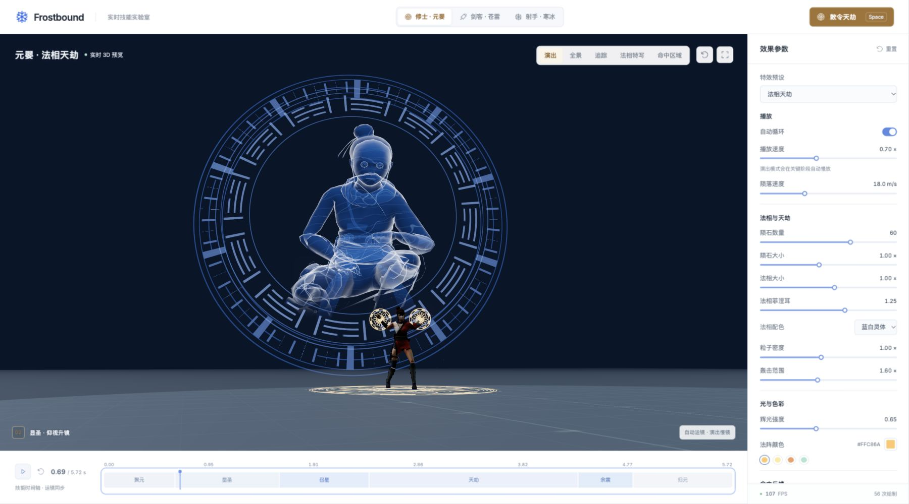

# 元婴 · 法相天劫

第三位角色使用用户提供的 `Standing 2H Magic Area Attack 02.fbx`，运行资产为 `public/models/standing-magic-area.fbx`。原始 Kachujin 身体与头发的基础色、法线贴图保留。49 个交错材质分组在载入时按材质重排为两个组，三角形及贴图对应不变。

## 法相与参考图

按用户确认采用蓝白灵体：深蓝半透明躯干、青白 Fresnel 轮廓与细密能量纹路，和暖色陨石、紫色目标法阵区分。法相使用原角色的独立骨骼克隆，约 10.5 米高。

法相专属动作来自用户提供的 `Standing (1).fbx`，运行资产为 `public/models/divine-standing.fbx`。此文件只有 75 根骨骼与一段约 2.77 秒、59 条轨道的起身动作，没有模型和贴图。其绑定骨骼与施法角色兼容；保留原始旋转和竖直起身，锁定根骨水平位移。动作映射到法相时间 0.28–2.53 秒，播完保持站姿；前景修士仍独立执行施法动作。可以从末帧向前定位后重播，不依赖前一帧的骨骼状态。

法相在 0.28–1.35 秒以统一透明度整体渐显。下身的柔化随腰部高度移动，避免起身时切掉头部；显形始终作用于整个身体。已移除周围的生成纹理飘带。先前的灵焰纹理及 [生成记录](cultivator-generation-prompts.md) 只保留为素材存档，当前预览不再加载或绘制它们。

背后仅保留两层外围轮盘，中央莲瓣星印已移除，给面部和躯干留出空白。外圈及符文圈转速为 +1.8、−2.8 rad/s（法相时间），保留前后间距；降低发光强度与透明度，主体轮廓成为视觉焦点。法相脚下的独立法阵不再显示，修士脚下施法阵保留。目标法阵维持紫光 `#9F42FF`。

光轮半径收至原来的 0.92 倍，中心随头部与腰部的中点上移，消除站定后下方过多的空白。测试以真实蒙皮顶点和相机投影检查起身全程，保证可见灵体轮廓处于外轮范围内。

## 时间轴

| 技能时间（默认约值） | 表现 |
| --- | --- |
| 0–0.65 s | 结印聚元，手心符文与地面法阵亮起 |
| 0.28–1.35 s | 法相整体渐显，同时缓慢起身 |
| 1.05–1.85 s | 天空法阵展开，陨石在法阵平面内生成 |
| 1.40–3.25 s | 外围光轮连续发射 48 发追踪灵光，密度可调至 96 发 |
| 1.60–3.40 s | 60 枚陨石依次落下，可调 12–84 枚 |
| 2.42–4.32 s | 连续落地或击中目标，独立冲击环、碎岩与余火 |
| 4.32–5.72 s | 残余轨迹、岩片、法阵、法相和火星完全消散 |

实际结束时间由陨落速度和最后一次命中决定。前景角色和法相分别取样两份动作。法相动作完成后保持末帧，技能末段整体淡出。暂停、反向定位和再次释放可复现相同状态。

## 陨石与性能

84 槽陨石实例池、504 槽实体碎岩池和 1,300 槽粒子缓冲固定分配。每颗陨石具有独立半径、生成时间、落点、加速落体与横向弧度；每 12 颗包含一颗较大的主陨石。起点均位于倾斜的天空法阵内，终点分布在目标及周边地面。

岩石由不规则多面体和熔岩裂纹 Shader 构成。两片交叉带状曲面采样真实过去轨迹，表现速度和火焰体积；命中后仍保留约 220 ms 的末端流火。各次冲击有独立的闪光、扩张冲击环、地裂、薄雾、弹道火星及旋转岩片，不通过整颗球体缩放模拟爆炸。

## 法阵追踪灵光

`HaloBolts` 默认发射 48 发，数量为 `clamp(round(48 * particleDensity), 12, 96)`。每发从发射时刻的真实旋转轮盘位置生成，先向外展开再沿三次曲线追向敌人。终点预采样目标的受击动作，命中后的闪光继续跟随当前胸口，避免角色后仰时脱离接触位置。

蓝白 HDR 核心、流动拖尾与独立发射光点形成层次；拖尾采样过去 0.28 秒的轨迹，命中后约 0.24 秒内收束。每次命中包含短促十字闪光、扩张光环与 7 片旋转碎片，碎片受重力影响并在 0.65 秒内缩小淡出。

96 个光弹实例、192 个闪光实例、672 个碎片实例及带状几何预先分配。调节密度、暂停定位和重新释放均复用这些缓冲，不随每发攻击创建新 Mesh。

## 八镜头演出

| 镜头 | 运镜与主体 |
| --- | --- |
| 结印 · 掌心推进 | 缓慢推进前景修士，交代释放者 |
| 显圣 · 仰视升镜 | 低机位上仰，随巨灵起身抬升并环绕；0.36× 分段倍率强调体量 |
| 法相 · 威仪近景 | 取实际头部、胸部骨骼位置，压近上半身并轻微侧移 |
| 天门 · 升空拉远 | 升镜拉开，交代天空法阵、巨灵及目标 |
| 陨星 · 俯冲跟拍 | 沿第一颗主陨石的实际位置与近端历史轨迹跟随，俯视目标 |
| 天罚 · 低机位冲击 | 切低机位表现首次重击，保留目标与近端冲击范围 |
| 镇世 · 环绕轰击 | 高位环绕连续落点，展示陨石群和紫色目标阵 |
| 归元 · 拉远收势 | 缓慢拉远，收束人物、法相及余烬 |

默认播放倍率为 0.70×，起身镜头叠加 0.36× 演出倍率，重点起身段约有四秒实际观看时间。非演出模式只应用全局倍率。后续切点按实际陨落速度计算，不绑定固定命中秒数。各镜头均有连续位置或视角变化；暂停、反向定位可准确复现同一构图。镜头按画幅与法相尺度自适应，OrbitControls 保留，角色切换会清空瞬态效果与附加光源。

低机位最小高度限制为 0.65 m，避免宽画幅拟合时相机进入舞台、被地台背面遮住。已在宽屏下复查用户报告的 0.69 秒显圣镜头：



## 接入

```js
import { Cultivator } from '../src/scene/Cultivator.js';
import { CultivatorSkill } from '../src/vfx/cultivator/CultivatorSkill.js';
import { defaults } from '../src/VFXConfig.js';

const config = { ...defaults, autoLoop: true };
const fighter = new Cultivator(scene, config);
const skill = new CultivatorSkill(scene, camera, config);
await fighter.ready;
skill.bindFighter(fighter);
await skill.avatar.loadStandingAnimation('/models/divine-standing.fbx');
fighter.setVisible(true);
skill.setActive(true);
skill.fire();

// 每帧：更新技能、更新相机，再刷新朝向相机的效果并渲染。
skill.update(deltaTime, deltaTime);
skill.refreshView();

// 实时参数：保留归一化进度，重算独立陨石时间。
config.meteorCount = 84;
skill.dirty = true;

// 退出时：
skill.dispose();
fighter.dispose();
```

完整应用由 `SkillShowcase` 负责三角色选择、共用目标、受击状态与 UI，并通过 `skill.bindActors(actors)` 为追踪灵光提供动态目标采样。`npm test` 覆盖材质保留、专属起身动作与末帧保持、法阵起点与落点、暂停重放、资源复用、参数极限、光轮包围、48/96 发追击、八镜头取景与最低机位、镜头内运动、不同飞速下的陨石跟拍。
