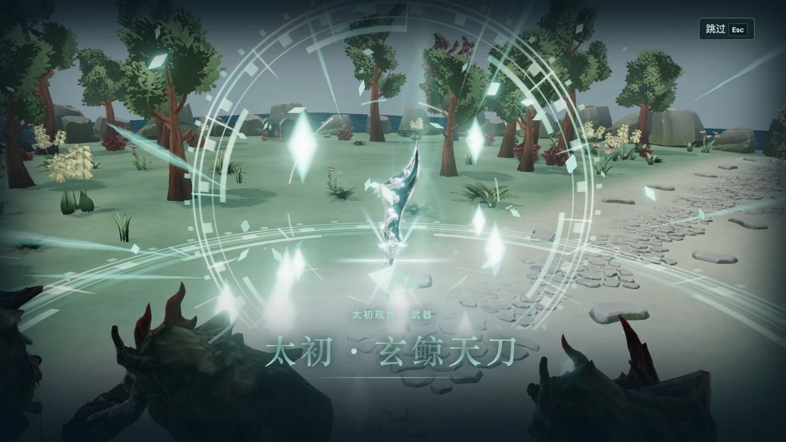
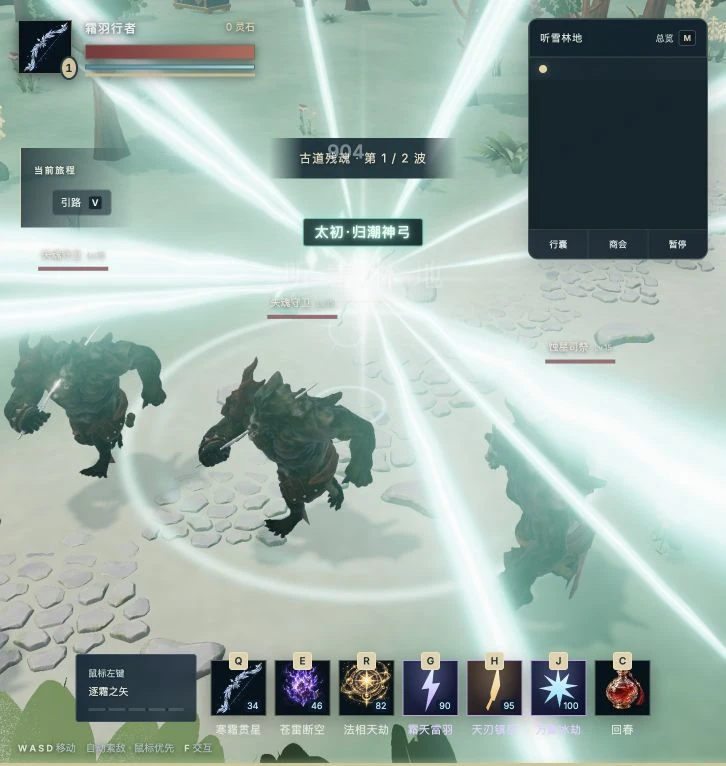
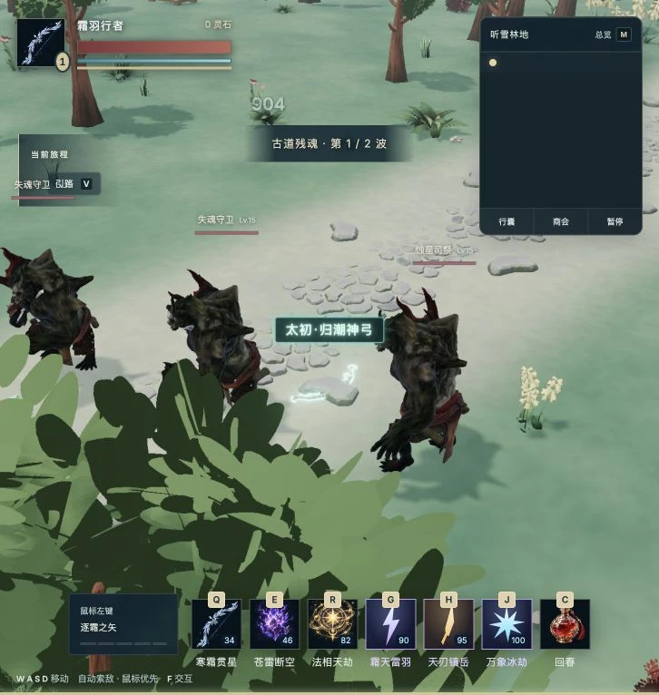
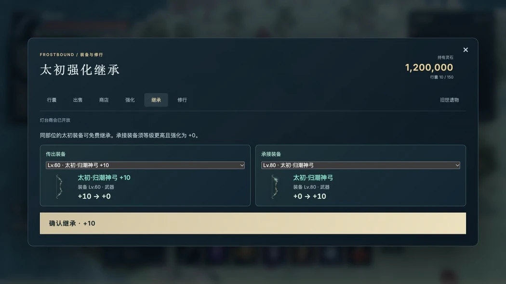
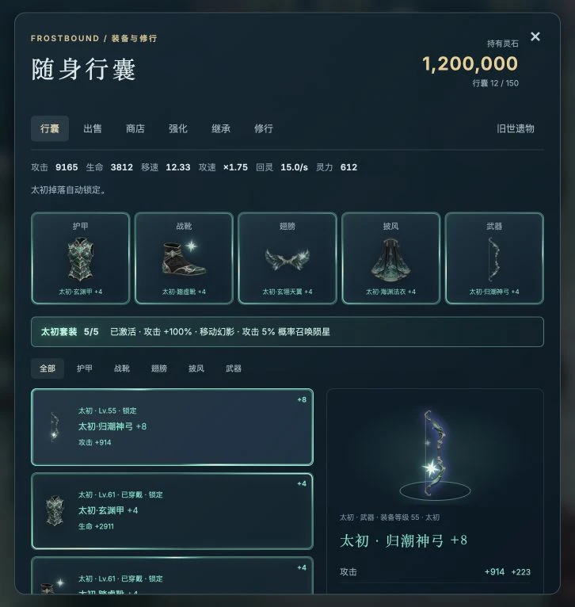
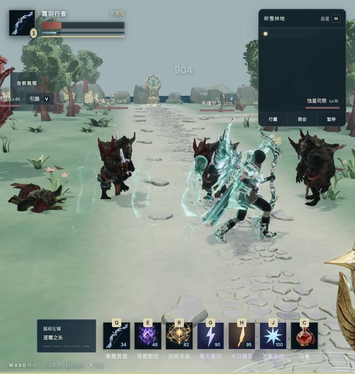
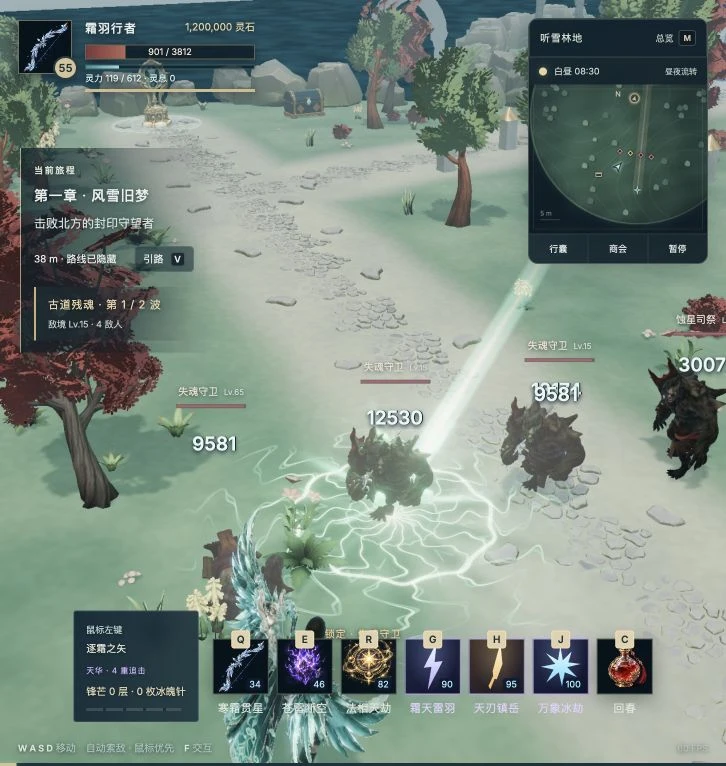

# 太初装备与轮回

达到 51 级后，每次击杀会独立判定太初。普通怪 0.025%、精英 0.08%、首领 0.35%。装备保底作用于常规掉落。太初装备默认锁定，满包时仍会留在行囊。史诗前缀调整为「天工」，原有物品按存档品质读取。

怪物随机抛出可拾取的灵石，随怪物等级和类型提高数量。靠近会自动吸附。未拾取灵石会随存档保留，在 60 秒后或开启下一轮时结算。角色 50 级后可继续升级，后段经验增量随等级加快。轮回持续提高敌方等级、攻击和防御，实战伤害受防御影响。

在行囊的「出售」页，可勾选装备、全选或反选当前分类。选中的跨分类装备会合并计价，确认后一次结算。锁定和已穿戴的装备受保护。

到安全灯台打开「继承」，可将低等级太初装备的强化等级免费移至同部位、更高等级的 +0 太初装备。传出件归零，承接件取得全部强化等级。确认前会并排显示两件装备的变化。

强化等级越高，模型的发光强度与边缘发光范围越大。强化成功与失败使用不同音色，太初掉落还有独立的识别音和落地音。[试听音色](../../public/game/audio/loot/treasure-chimes-v2.wav)

太初爆出时暂停战斗约 1.5 秒，并展示实体装备。恢复战斗后，半空的装备带出与史诗同形的放射光束。方向固定，青白核心和尖芒在两个亮度峰值间闪烁。触地时放射光消失，装备轮廓短促加亮，随后保留细描边和高亮名称。背包采用斜扫光文字、错峰星芒和沿物品格转动的流光边框。

护甲、鞋、翅膀、披风、武器全部穿戴太初后，面板总攻击力翻倍，奔跑和闪避可留下最多四道随动作取样的菲涅耳残影。每次成功的有目标普攻或主动攻击技能，独立获得一次 5% 的陨星判定。陨星在目标当时的位置预告落点，约 0.68 秒后对落点周围 4.2 米内的敌人结算伤害。多弹道、持续伤害和陨星伤害不会追加判定。行囊中可查看五件套的激活状态。

七件装备的原始概念图使用内置 ImageGen 生成，图生 3D 使用火山方舟 Seed3D 2.0。运行用的 GLB 位于 `public/game/models/equipment`，包括甲、靴、翼、披风、刀、剑、弓。掉落使用适合实时渲染的低面数副本。 [完整图像提示词](../../asset-specs/equipment-taichu.json) · [模型规格](../../public/game/models/equipment/taichu-manifest.json) · [生成接口文档](https://docs.volcengine.com/docs/ark/create-3d-generation-task-api?lang=zh)
