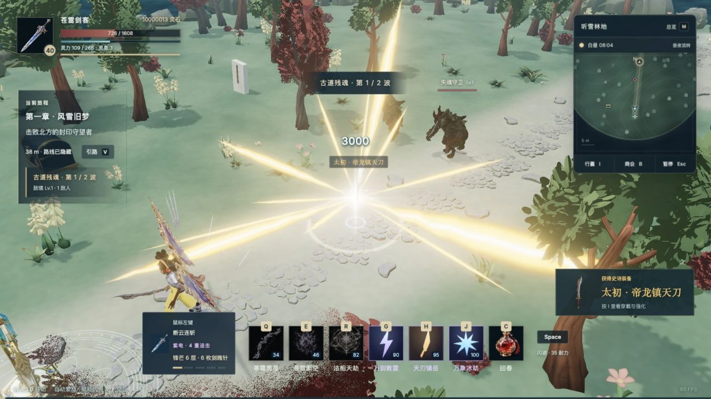

# 装备与觉醒第二轮打磨

2026-11-04。本文记录 `game.html` 的战斗与装备更新。

## 外观与穿戴

20 级或强化 +8 解锁中阶外观，35 级或强化 +16 解锁高阶外观。等级和强化取较高的阶段，属性按装备数值计算。

| 类别 | 基础 | 中阶 | 高阶 |
| --- | --- | --- | --- |
| 翅膀 | 琉光之翼 | 星羽天翼 | 九霄凤翼 |
| 披风 | 归墟披风 | 星河法衣 | 帝阙凤氅 |
| 弓 | 寒霜弯弓 | 星龙灵弓 | 帝龙破穹弓 |
| 刀 | 斩星灵刀 | 苍龙斩月刀 | 帝龙镇天刀 |
| 剑 | 苍雷长剑 | 天罡星剑 | 太初帝剑 |

本轮生成两款翅膀、两款披风、两款弓、一把高阶刀和一把高阶剑，共八件新 3D 资产。刀剑的基础与中阶共用网格，通过尺寸与强化 Shader 区分，高阶采用独立模型。弓手装备弓，剑客与修士可获得刀或剑，旧武器实例自动补全家族类型。

披风使用四段弹簧阻尼控制点，羽翼使用左右独立惯性铰链。驱动力来自实际移动速度、加减速和转身角速度，叠加轻微风动。转弯会造成左右不同的回摆，急停后逐渐稳定。每帧只更新小型数组，GPU 同时变形 PBR 表面与阴影。这套次级运动采用游戏用弹簧近似。

领口从实际网格上缘采样深度，贴到肩后，下摆朝身体外侧弯曲。高阶模型更长、更宽，但肩部挂点固定。弓沿 YZ 发射平面校准握把及上下弦点，换弓沿用原掌心约束和动态弓弦。装备实例切换与强化复用附件、几何、贴图，不在每次加级时重建整套对象。

## 掉落闪光与音色

| 品质 | 爆出的瞬间 | 对应声音 |
| --- | --- | --- |
| 普通 | 四束短银白晶芒，0.34 秒内收尽 | 一声短促的银扣轻响 |
| 稀有 | 七束紫色棱光，中心短闪后留有紫色余辉 | 两声音程分明的玉磬 |
| 史诗 | 亮白核心爆出十二道金色光束，较宽的前景光扇与斜向长芒错开，随后落下金屑 | 低铜钟起音，叠入三声上行金磬 |

光束从敌人所在的三维位置射出，出场时确定朝向。物品采用 15 种实际装备轮廓的低面数模型，共 9,683 个三角形。每件装备翻转着飞过 0.66–0.80 秒的抛物线，在实际落点弹出一圈较小的回光，并播放所属品质独立的落地轻响。稀有与史诗留下细光柱。名称和词条分别使用银白、紫、金三种颜色。

六段原创音色共用一份 247 KB 的单声道 PCM。距离决定响度，镜头方向决定左右声像。同帧、同阶段的掉落优先播报最高品质，同品质取最近一件。爆出和落地分别限频，共用六个并发声部。可用 `node scripts/prepare-loot-audio.mjs` 重制。[试听原始音色](../../public/game/audio/loot/treasure-chimes-v1.wav)

GPU 以四组实例化绘制复用 32 个闪光槽。极近且同时出现的掉落合并，保留最高品质。场景最多显示 96 个实物与 12 个屏幕标签，名称优先显示高品质并避开相邻标签。物品落地停留 0.24 秒后，在 7 米内自动吸附。存档包含飞行进度和落点，120 秒后尚未拾取的装备依照原寄存规则入包。

## 天刃与冰暴

H 天刃召出时刀柄贴地、刀尖向上。挥落采用抬柄、转刃、落刃的连续姿态，接触时长刀横在攻击区域，切削刃朝地面，刀尖沿斩击方向向前。历史刃缘生成一整片挥砍拖尾。落地增加短促十字闪爆、地表扩散冲击、定向金色能量与飞散碎片，随后回正消散。

J 冰暴每波提前锁定敌人的 XZ 落点，实体冰箭只沿世界 Y 轴加速下落。晶体轮廓加宽，尾部具有流动渐隐的青白细光带。冰箭保持竖直，触地后的细碎冰晶旋转散开。每波重新寻找领域内的敌人，落点特效、局部伤害和冰冻判定共用同一计划。九波冰击和三职业立绘保留。

## 性能处理

原先觉醒点光源位于隐藏的特效组中。技能显隐会改变场景光源数量，导致已经预编译的材质在第一次释放时重新编译。现在雷击和巨刃只提交光照提示，复用一盏始终存在的场景光源，固定光源结构。

加载阶段在正式光照条件下编译 Shader、上传纹理，并用 8×8 离屏渲染准备隐藏粒子池、实体冰箭、掉落物和敌人材质。透明双面 Shader 使用单次绘制。精英颜色改为统一 Shader 的参数，避免每种精英颜色产生新程序。小物品使用单独低面数图集库，真实穿戴模型保留高阶轮廓和 PBR 纹理。

### 实测

Apple M5 / macOS / Codex 内置 Chromium，1280×720、DPR 1、高画质、18 个真实敌人，逐项首次施放，记录每项 7.6 秒的实际 `requestAnimationFrame` 间隔。基准代码为改动前冻结的构建。两版均使用相同画幅、角色、敌人数量、技能顺序和画质。仅开启一个测试 WebGL 页面。

| 技能 | 旧版最长帧 | 更新后最长帧 | 更新后 P95 | 更新后 >33.4ms 帧数 |
| --- | ---: | ---: | ---: | ---: |
| G 落雷 | 84.5 ms | 18.2 ms | 10.1 ms | 0 |
| H 天刃 | 108.4 ms | 17.0 ms | 10.3 ms | 0 |
| J 冰暴 | 1609.9 ms | 16.7 ms | 9.7 ms | 0 |
| R 法相 | 未采集 | 10.4 ms | 9.9 ms | 0 |
| Q 冰箭 | 未采集 | 10.4 ms | 9.3 ms | 0 |
| E 剑气 | 未采集 | 10.4 ms | 9.9 ms | 0 |

旧版 G / H / J 各新增 21 / 24 / 17 个 Shader 程序；更新后这三次施放只分别新增 1 / 0 / 0 个程序。新版本六轮记录均无浏览器 Long Task。[查看原始采样](equipment-v2-performance.json)

高密度屏幕另以 2240×1260 的实际渲染缓冲检查画面。装备材质对菲涅耳指数运算的底数做了范围约束，消除了高亮像素传入 Bloom 后偶发的矩形黑斑。这次最终构建中，G、H、J 在该分辨率下的首次施放最长帧分别为 42.0、50.2、51.0 ms。三项 P95 分别为 16.8、16.8、18.0 ms。另让 18 个敌人在同一帧掉落 18 件装备，三种品质各六件，在 7.6 秒内记录了 786 帧，P95 为 16.7 ms，最长 25.0 ms。实际帧率取决于硬件、分辨率和战斗规模。

## 生成与资源

图像提示词原文：[EQUIPMENT-V2-PROMPTS.json](EQUIPMENT-V2-PROMPTS.json)。八张透明概念图由 ImageGen 生成，随后传入 `doubao-seed3d-2-0-260328` 生成 GLB。生成只在离线制作时进行；运行游戏不调用生成 API。

| 资源 | Seed3D 任务 | 运行版三角形 |
| --- | --- | ---: |
| wings-star | cgt-20261104203215-jpbq5 | 7,999 |
| wings-phoenix | cgt-20261104203217-kxts2 | 7,994 |
| cloak-star | cgt-20261104203220-hclz8 | 7,000 |
| cloak-imperial | cgt-20261104203221-z45hw | 6,994 |
| bow-star | cgt-20261104203223-v4ggq | 7,000 |
| bow-imperial | cgt-20261104203226-gfjxl | 6,999 |
| dao-imperial | cgt-20261104204351-rzt99 | 7,000 |
| jian-imperial | cgt-20261104204353-vvlkn | 7,000 |

生成规格位于 `asset-specs/equipment-v2.json`。原图与 3D 母版保留在本地忽略目录 `assets/rpg-source/art/equipment/variants`、`assets/generated`。运行模型在 `public/game/models/equipment`，512px WebP PBR；UI 图片在 `public/game/art/equipment`。低面数掉落库使用 128px 贴图，不替代实际穿戴模型。

复现优化：`node scripts/prepare-equipment-variants.mjs`，随后 `node scripts/prepare-loot-library.mjs`。脚本采用属性感知的网格简化，保留法线与 UV；生成调用支持已完成任务恢复，GET 短暂失败有有限重试，不盲目重复提交付费任务。密钥不进入仓库。
