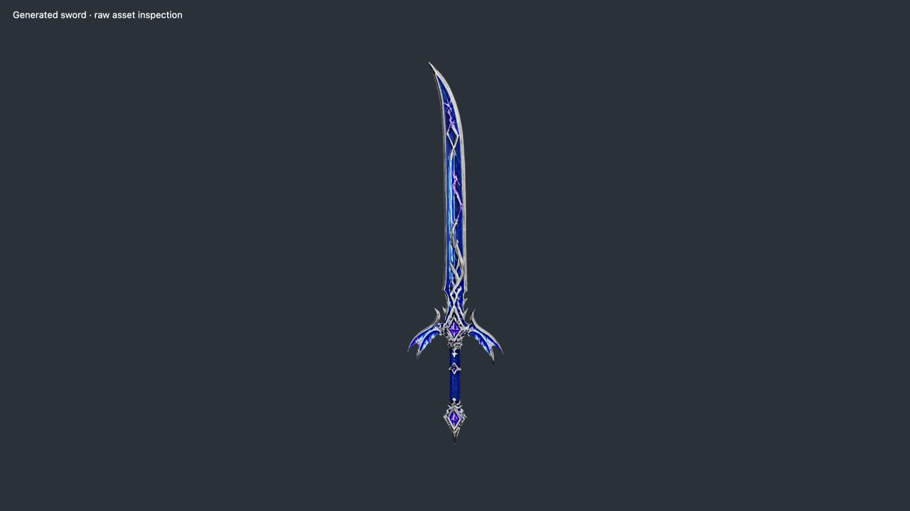
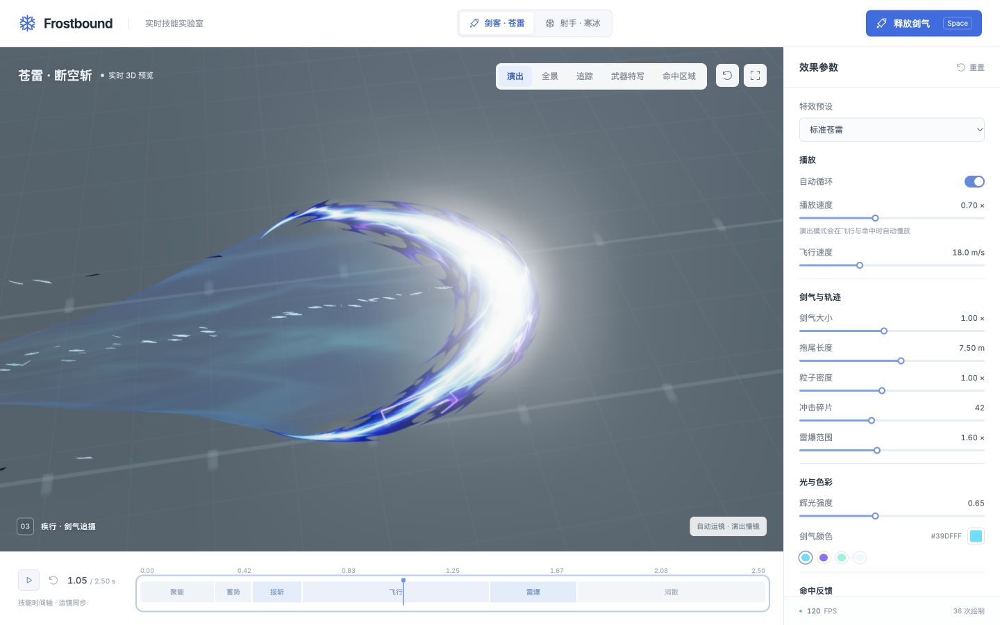
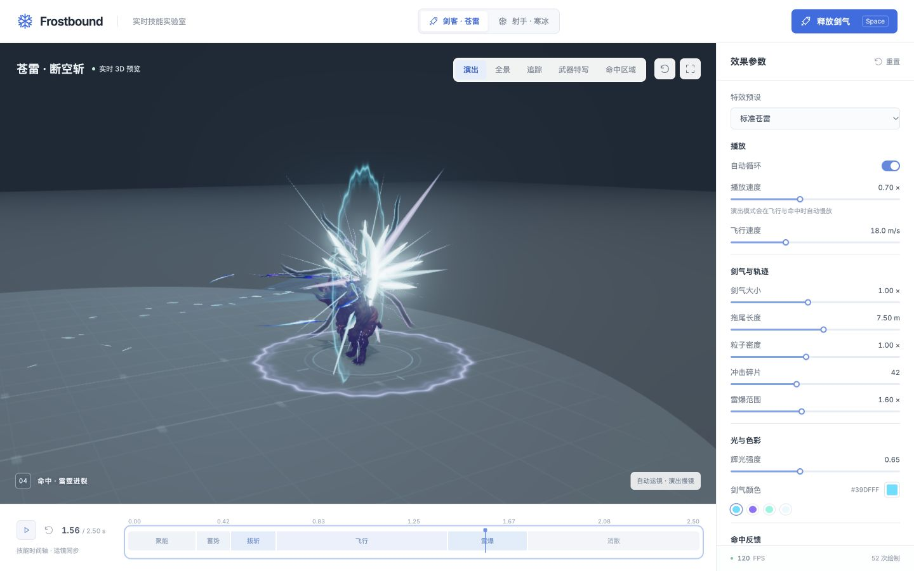

# 苍雷 · 断空斩

苍雷剑客与原寒冰射手是两套独立的释放者与技能。顶部“剑客 · 苍雷 / 射手 · 寒冰”切换当前角色、技能参数、阶段标签和演出相机；原 Akai 射手与 Warrok 受击目标继续保留原始材质。新增剑客使用 `public/models/standing-melee-360.fbx` 的旋身挥剑动作，共用场景中的受击目标。

月刃采用生成式 RGBA 手绘素材的真实轮廓和原图 UV，构造成有厚度的 3D 网格；显形、流动、整体连续拖尾、闪电、粒子与雷爆由 Three.js 和 GLSL 实时驱动。手持实体剑与飞行月刃是不同对象：实体剑跟随右手骨骼，月刃在挥斩时沿实际剑尖和挥剑平面形成，再脱离角色飞行。AI 用于离线制作参考图、武器网格和 VFX 纹理，不参与实时帧计算。

## 生成资产

- 实际加载的 `public/models/storm-sword-v3.glb` 已在浏览器确认是完整银钢/钴蓝长剑，右手握持位置正确。运行版 **67,302 三角形、3,258,632 B（3.26 MB）**；本地母版 **336,519 三角形、19,885,768 B（19.89 MB）**。
- 剑保留两张 **4096×4096 WebP**：基础色与金属度/粗糙度；**没有法线贴图**，使用网格法线。源模型沿 +Y，归一化总长 1.5 m，握点参数 `gripFraction = .17`。
- 概念图 `public/concepts/storm-sword-v1.png` 为 1024×1536 RGBA；最终生成输入为白底 `storm-sword-v2.png`，1024×1536 RGB。
- `public/textures/anime-crescent-v1.png` 为 **1254×1254 RGBA、936,405 B**，提供手绘月刃轮廓、宽亮芯、青蓝/紫色带与不对称尖端。加载时从 alpha 主体构造 **9,856 三角形**的闭合网格。
- `public/textures/storm-energy-flow.png` 为 1254×1254 RGB；月刃 Shader 在三层 FBM 上以 18% 权重混入其灰度结构，形成细微流动变化。流动纹理加载失败时仍有程序化噪声；手绘月刃加载失败时使用程序化厚月刃回退。
- 前两轮 Hyper3D 模型均因内容错误而拒绝，只保存在排除交付的本地目录。成功 v3 使用 Ark 的 `doubao-seed3d-2-0-260328` 与白底参考图，文本仅为参数，没有描述性提示词或 seed。

完整生成记录、优化命令与凭据边界见 [生成资产说明](generated-assets.md)，图像提示词见 [图像生成记录](sword-generation-prompts.md)。



## 动作与时间轴

所有表格时间都是**技能时间**。演出慢镜和面板播放倍率改变观看时长；命中停顿额外暂停实际播放，不改变时间轴上的事件时间。

| 阶段 | 时间 | 实际表现 |
| --- | --- | --- |
| 聚能 | 0–0.30 s | 剑身周围的螺旋吸入粒子、三条收束能量带及间歇分叉电弧 |
| 蓄势 | 0.30–0.45 s | 旋身蓄力、能量收紧；飞行月刃仍隐藏 |
| 拔斩与月刃生成 | 0.45–0.65 s | 骨骼剑身留下真实挥剑轨迹；手绘月刃随剑尖运动，沿本地轮廓单向显形 |
| 发射与飞行 | 0.65 s–命中 | 短促拉伸和释放碎片，完整月刃携整体连续尾流、细流光及雷电前进 |
| 雷爆 | 命中–命中后 0.35 s | 闪光、锐角光芒、双冲击环、分叉雷电、实体碎片与空间裂痕 |
| 消散 | 命中后 0.35–1.10 s | 碎片旋转下坠、残余粒子与裂痕消退，最终清空瞬态效果 |

命中时间由 `0.65 + 实际飞行距离 / flightSpeed` 计算，总时长为命中时间加 1.10 秒。默认 18 m/s 下约在 1.4 秒命中、约 2.5 秒结束；绑定角色后以界面的实际时间为准。改变飞行速度或月刃大小会重算接触位置与时长，并保留当前飞行进度或命中年龄。

`SwordFighter` 保留源 FBX 的髋部旋转轨迹，包括动作本身的 360° 旋身；仅将髋部 X/Z 平移固定在起点，避免整个人随根运动离开演示位置。动作源片段约 3.167 秒，通过连续时间映射对齐蓄力、挥斩和收势，其中源片段 **1.075 秒**的前向出剑姿势精确对应技能 **0.65 秒**。实体剑沿局部 +Y，从右手掌的握持点伸出；`sampleSwordPose()` 可以采样任意技能时刻而不改变当前可见姿势。

`SwordSlashSkill.bindFighter()` 绑定角色后，采样释放前后各 20 ms 的剑尖位置，以**实体剑方向与剑尖速度的叉积**确定挥剑平面。当前真实 FBX 的释放斩面接近水平。0.45–0.65 秒生成阶段的中心跟随当前剑尖、朝向跟随剑身；0.65 秒从精确采样的释放剑尖出发，随后约 150 ms 内平滑对准目标并保留挥剑平面。控制器还根据实体包围范围做必要的离地校正。月刃前沿约为本地 `0.75 × bladeSize`，因此中心终点从目标后退相应距离。

`slashOrientation` 描述完整斩面的世界姿态，`orientation` 则是扣除内部 25° 预旋转后的实际 `blade.group.quaternion`。因此内部坐标约定不会把月刃固定成竖直斩面；生成、飞行、闪电和拖尾使用同一个真实姿态。

`SwordSwingTrail` 在 **0.45–0.65 秒**记录每次模拟采样的实体剑根/剑尖世界坐标，连接成随挥剑运动展开的短残影；0.65 秒停止新增，最晚在 **0.82 秒**完全消失。它与向目标飞行的 `SwordTrail` 分开，能表现旋身动作自身的刀光。64 槽采样与四条径向顶点带固定复用。

命中后月刃在 **220 ms** 内从刃口向后缘侵蚀，尚存部分继续保留体积和流动能量；中心同时向前推进。`SwordTrail.impact()` 补齐最后采样到接触点的轨迹，随后在 **340 ms** 内将拖尾向接触点输送、收束并淡出。

开启命中停顿时，正常播放在接触时暂停约 **50 ms 实际时间**；`seek()` 重建和逐帧检查不插入这段等待。停顿不使用阻塞式 sleep，也不增加技能的总时长。

## 月刃、轨迹与雷爆

`PaintedCrescentBlade` 在加载时以 alpha 阈值 **24/255** 提取最大连通主体，排除孤立飞点，再逐行读取后缘和前缘，构造前后表面及边界闭合的薄透镜网格。默认局部包围尺寸约 **3.567 × 3.6 × 0.08 m**，共 **9,856 三角形**，原图比例与不对称尖端保留。贴图中的透明缺口由 Shader 继续保留；它不是一张面向相机的矩形图片，旋转观察时能看到真实截面。

UV 直接映射原始 RGBA 图的白青亮芯、青色/钴蓝色带和深紫暗部。Shader 使用原图亮部遮罩产生局部 HDR 与移动高光，保留外围饱和色块；三层 FBM、18% 灰度流动纹理和少量 Fresnel 仅增加能量变化，不重新绘制或扭曲主体色带。`formation` 沿本地轮廓单向显形，`impact` 控制接触后的侵蚀，释放瞬间还有短促几何拉伸。原 `CrescentBlade` 只作为纹理尚未加载或加载失败时的回退。

`SwordTrail` 使用真实飞行历史，按距离补点，并把每行 25 个横向顶点连成**一整片连续、带浅厚度的能量体**。加载完成后由 `getTrailProfile()` 提供手绘月刃的实际凹后缘，取样略向内部偏移以稳定接缝；全截面随后迅速收窄，末端合并成一个尖点。前后表面和边界共同属于一个 Mesh，青蓝/钴蓝/紫色流动都在同一表面内，没有中央光绳或独立上下轨道。

尾流使用低透明度和较弱对比，接缝处进一步淡化，让主月刃的后掠缺口可见；稀疏的方向性侵蚀打破边缘，亮度始终低于主刃。384 槽历史池同时记录位置与 quaternion，高速补点使用旋转球面插值，旧截面保留当时的真实挥剑平面。最多 256 行截面与固定 GPU 缓冲反复复用。体积在世界空间中构造，相机旋转不会把它重排成平面；暂停刷新不新增历史。

`BranchingLightning` 将每条主电弧细分为多段折线，再从中间节点分叉，使用两张相交窄带提供可见厚度。飞行时主弧和分叉使用手绘月刃的表面采样器与当前世界矩阵，遇到透明缺口会选择邻近有颜色的表面点。各支电弧按不同周期出现和消失，局部 HDR 淡紫芯与细分叉形成高亮细节；几何缓冲固定复用。

`SwordParticles` 区分七类运动与外观：

| 类别 | 表现 |
| --- | --- |
| `CHARGE` | 沿螺旋轨迹向实体剑身收束 |
| `SLASH` | 释放瞬间向外爆发的短线光粒 |
| `STREAK` | 飞行中的细长速度流光 |
| `PEEL` | 沿运动方向剥离的有厚度尖片，混合亮色与暗色残片 |
| `SPARK` | 少量短寿命星形雷光 |
| `SHARD` | 命中后带旋转与重力的实体碎块 |
| `RESIDUAL` | 慢速散落、逐渐消失的残余微粒 |

方向性流光采用尖头收束轮廓，实体碎片混入深蓝近黑碎片，借亮暗交替强调速度。

点粒子使用 1200 槽 `BufferGeometry`，实体碎片使用 192 个可复用实例。每个元素具有独立寿命、速度、大小、旋转和透明度；随机序列在重置后复现，便于反复定位同一时刻。

`SwordImpact` 的六个视觉层为：短促接触闪光与醒目的白青弧斩、18 条三角形放射光芒、延迟 60 ms 的第二圈冲击波、放射状分叉雷电、最多 96 个有厚度的碎片、7 条逐渐张开并侵蚀的空间裂痕。碎片包含少量明显更大的定向亮刃和暗色飞片，突出演示参考中的尖锐爆发方向。冲击环同时覆盖倾斜立面与地面；碎片受到阻力、重力、缩小和淡出影响，全部命中资源在 1.10 秒后回收。





## 参数与相机

顶部按钮选择角色后，主按钮显示“释放剑气”或“发射冰箭”。剑客参数包括自动循环、播放速度、飞行速度、月刃大小、拖尾长度、粒子密度、碎片数量、爆发范围、辉光与剑气颜色，以及命中停顿、轻微震屏和命中闪光三个开关。原射手的箭体大小、追踪小冰箭数量和冰霜颜色仍独立保留。两种技能共享播放与通用效果参数；具体默认值以 `src/VFXConfig.js` 为准。

剑客预设为**标准苍雷、雷霆重斩、清透剑芒**。切换预设保留相机模式；恢复默认参数保留当前选择的角色。快捷键仍为 Space 释放、P 暂停、C 演出/全景切换、←/→ 前后移动 1/60 技能秒、R 恢复全景。时间轴可拖动回看。

`SwordCinematicDirector` 与原箭技能的六镜头导演独立：

| 镜头 | 窗口 | 构图 |
| --- | --- | --- |
| `charge` / 势起 · 苍雷蓄力 | 0–0.45 s | 上半身、双手和完整实体剑，缓慢推进 |
| `slash` / 断空 · 旋身斩月 | 0.45–0.78 s，最晚至命中 | 稍宽的斜侧构图，保留旋身动作与完整月刃 |
| `flight` / 疾行 · 剑气追摄 | 0.78 s–命中 | 月刃正面斜跟拍，包含完整弧体与 3.1–3.7 m 近端轨迹 |
| `impact` / 命中 · 雷霆迸裂 | 命中后 0–0.45 s | 固定主体构图，保留冲击环、目标和碎片 |
| `resolve` / 余波 · 残雷消散 | 命中后 0.45 s–结束 | 轻微环绕和拉远，观察残留消散 |

剑气镜头留在动作轴线的 +Z 侧，并根据实际斩面法线提高观察位置，让当前近水平的月刃正面可见。飞行只有浅角度轨道移动，避免把薄月刃转成难以辨识的侧边。手绘网格的实际包围范围与世界姿态参与视锥适配，窄屏仍保留完整月刃；更长的历史轨迹可以伸出特写范围，全景模式可看完整航迹。

附加演出倍率分别为蓄力 **0.72×**、0.45–0.65 秒挥斩 **0.90×**、发射后飞行 **0.55×**、命中后的前 0.45 秒 **0.52×**、收尾 **1×**，再与全局播放速度相乘。开启震屏时，接触后 150 ms 内叠加确定性相机偏移，幅度小于 5 cm；没有随机相机漂移、景深模糊或额外曝光跳变。

## 接入接口

```js
import { SwordSlashSkill } from './src/vfx/sword/SwordSlashSkill.js';
import { SwordFighter } from './src/scene/SwordFighter.js';
import { SwordCinematicDirector } from './src/scene/SwordCinematicDirector.js';
import { defaults } from './src/VFXConfig.js';

const params = { ...defaults, autoLoop: false };
const fighter = new SwordFighter(scene, params);
const skill = new SwordSlashSkill(scene, camera, params);
const director = new SwordCinematicDirector(camera);
await fighter.ready;
await fighter.loadSwordAsset('/models/storm-sword-v3.glb', {
  height: 1.5, rotationXYZ: [0, 0, 0], gripFraction: .17,
});
// 可选纹理载入失败时，保留程序化厚月刃。
await Promise.allSettled([skill.blade.loadTexture('/textures/anime-crescent-v1.png', {
  alphaThreshold: 24,
}).then(() => {
  const profile = new Float32Array(25 * 3);
  if (skill.blade.getTrailProfile(profile, 25)) {
    skill.trail.setProfile(profile, { launchStretch: true });
    skill.lightning.setSurfaceProvider(skill.blade);
  }
})]);
skill.bindFighter(fighter);
fighter.setVisible(true);
skill.fire();

// 已有 requestAnimationFrame 中，dt 为真实秒数：
const tempo = params.cameraMode === 'cinematic' ? director.getTimeScale(skill) : 1;
skill.update(dt * tempo, dt); // 第二个参数保留真实时间，用于 50 ms 命中停顿
fighter.update(skill.timeline.time, skill.timeline.phase, skill.timeline.impactTime);
if (params.cameraMode === 'cinematic') director.update(skill, camera.aspect);
skill.refreshView();
// 交给已有 EffectComposer 渲染。

// 暂停并定位；不会等待命中停顿。
skill.timeline.playing = false;
skill.seek(skill.timeline.impactTime + .12);

// 退出时：
skill.dispose();
fighter.dispose();
```

`fighter.loadSwordAsset(url, options)` 保留模型 PBR 材质并校准握点。以上 v3 参数已在浏览器验证；更换剑模型后需要重新检查比例、剑根和握点。完整入口使用 `Promise.allSettled`，在可选武器加载失败时保留程序化实体剑。`SkillShowcase` 负责在剑客和射手之间切换，并保持 UI 与相机的公共接口稳定。

独立视觉模块：

- `PaintedCrescentBlade.update(time, { formation, life, impact, phase, config })`；父级控制位置与旋转，`getTipPositions()` 输出原画尖端的世界坐标。
- `loadTexture(url, options)` 构造手绘轮廓；`getTrailProfile(out, count)` 输出含内部预旋转、未包含父级尺度和姿态的后缘；`sampleSurface(u, v, out, options)` 和 `surfaceFrame` 供表面效果跟随。
- `SwordTrail.setProfile(profile, { launchStretch: true })` 接入实际后缘；`update(dt, time, position, emitting, camera, config, direction, orientation)` 的最后一项是确切的 `blade.group.quaternion`；`impact(target, time, orientation)` 开始收束，`reset()` 重用全部缓冲。
- `SwordSwingTrail.update(dt, time, base, tip, config)` 使用实体剑的实际世界端点，暂停刷新不会重复追加样本。
- `SwordParticles`、`BranchingLightning`、`SwordImpact`、`SwordAura` 各自管理并释放资源，不依赖 UI。

## 验证范围

月刃/整体拖尾测试使用实际 RGBA 素材检查最大主体提取、原图比例与 UV、闭合体积、真实厚度和表面闪电；同时覆盖大小独立性、程序化回退、历史位置与旋转补点、缓冲复用、25 点后缘接缝、单一连通体、末端收尖、340 ms 收束和暂停稳定性。挥剑残影测试覆盖骨骼端点采样与清理；剑气导演测试覆盖往返定位、不同宽高比与大小的取景、月刃正面可见性、平滑追踪、震屏边界和慢镜倍率。

完整项目验证入口为 `npm test` 与 `npm run build`。生成剑 v3 的模型、材质和握持已在本机浏览器确认；Shader 的分数次幂输入加入非负保护，避免无效值污染后处理。离线测试不代替 GPU 编译或视觉验收，没有给出固定 FPS、跨显卡兼容性或统一硬件性能结论。
